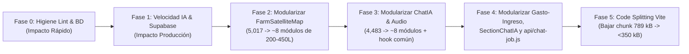

# Plan de Optimización Integral — App Campito Jorox

**Fecha:** 12 de noviembre de 2026  
**Respaldo previo creado:** `backup-pre-optimizacion-20261112.zip` (493 KB, 64 archivos fuente y configuración)  
**Estado base verificado:**
- **Líneas totales (`src/` + `api/`):** `20,690` líneas JS/JSX (`21,192` incluyendo `src/index.css`).
- **Build (`vite build`):** `1.07 s`, con chunk de aviso >500 KB: `FarmSatelliteMap` (**789.12 kB** / 243.28 kB gzip), `index` (**468.65 kB**), `ChatIA` (**272.90 kB**).
- **Linter (`npm run lint`):** **7 errores** (`react-hooks/set-state-in-effect`) y **1 warning** (`react-hooks/exhaustive-deps`).

---

## Diagnóstico Cuantitativo (Archivos Críticos)

| Archivo | Líneas | Bloque dominante / Problema principal |
| :--- | :---: | :--- |
| `src/components/FarmSatelliteMap.jsx` | **5,017** | `styles`/`stylesPage`/`stylesFilter` (~1,295 líneas), lógica Leaflet + filtros + trazado + panel detalle + barra IA + modales en un solo archivo. |
| `src/pages/ChatIA.jsx` | **4,483** | Formateo de contexto + `callGeminiDirect` (333 líneas), `styles` (385 líneas), 3 modales (servidores, info, catastro 3 pestañas), grabadora audio/GPS y chat. |
| `src/pages/gasto-ingreso.jsx` | **1,971** | Formulario alta, balances, tabla/tarjetas, panel lateral de filtros, modal de edición/papelera y visor de imagen en un único componente. |
| `src/components/SectionChatIA.jsx` | **1,696** | Grabadora `MediaRecorder` + preview de audio duplicada respecto a `ChatIA.jsx` y `styles` (444 líneas). |
| `api/chat-job.js` | **1,001** | Cascada fija con `gemini-3.1-pro-preview` primero para todo tipo de peticiones; lógica de acciones de calendario, finanzas y chat mezclada con gestión de jobs. |
| `src/pages/Calendario.jsx` | **959** | Tamaño manejable, pero con 1 error de lint (`set-state-in-effect`) y 1 warning (`exhaustive-deps`). |

> **Regla de ejecución recomendada:** Trabajar en **conversaciones nuevas por cada fase** (o usar `/compact` si se continúa en el mismo hilo) y validar `npm run lint && npm run build` **al cierre de cada bloque**, no tras cada micro-edición. No ejecutar `git push` ni despliegues sin instrucción explícita (`GIT PUSH` / `UPLOAD`).

---

## Arquitectura Objetivo por Fases

---

## Fase 0 — Higiene Base: Lint a 0 Errores (30–45 min)
**Objetivo:** Dejar `npm run lint` en **0 errores y 0 warnings** para que las validaciones posteriores no arrastren ruido.

- [ ] Corregir los 7 errores `react-hooks/set-state-in-effect`:
  - `src/components/FarmSatelliteMap.jsx` (líneas 287, 295, 379): derivar estado o sincronizar mediante callbacks/lazy initializers en lugar de `setState` síncrono dentro de `useEffect`.
  - `src/components/Layout.jsx` (línea 95): limpiar búsqueda en el handler de navegación o ajustar patrón sin efecto síncrono.
  - `src/hooks/useDataCache.js` (línea 31): envolver la carga inicial en función `async` interna al `useEffect` o evitar `setLoading(true)` síncrono previo al `await`.
  - `src/pages/Calendario.jsx` (línea 56 + warning línea 46): memoizar `rawEvents` y resolver `targetDate` sin `setState` síncrono en `useEffect`.
  - `src/pages/ChatIA.jsx` (línea 1212): resetear `isPreviewPlaying` / `previewCurrentTime` en los handlers de `pendingAudio` (`onClearAudio`, `onAudioReady`) en vez de hacerlo síncronamente en `useEffect`.
- **Verificación:** `npm run lint` → 0 errores, 0 warnings.

---

## Fase 1 — Acelerar Respuestas IA y Eliminar Errores `404` en Producción (Impacto Medio-Alto)
**Objetivo:** Reducir latencia de `Chat IA` y `SectionChatIA` en Vercel y eliminar peticiones `404` innecesarias a Supabase.

1. **Enrutamiento inteligente de modelos en `api/chat-job.js` (`DEFAULT_MODELS`, líneas 11–16):**
   - Cambiar la prioridad por defecto para peticiones de texto/calendario/contabilidad simple a:
     1. `gemini-3.5-flash` (rápido y preciso)
     2. `gemini-2.5-flash` (equilibrado, 1M contexto)
     3. `gemini-3.1-flash-lite` (respaldo de cuota)
     4. `gemini-3.1-pro-preview` (solo fallback o ruta `complex` cuando haya PDF/imagen pesada, audio largo o solicitud explícita del usuario en `ChatIA`).
   - Revisar también `GEMINI_SERVERS` en `src/pages/ChatIA.jsx` (líneas 78+) para alinear la selección manual vs automática (`Auto-Rápido` vs `Pro`).
2. **Crear las 5 tablas faltantes en Supabase:**
   - Ejecutar los scripts ya presentes en `scripts/`:
     - `scripts/setup_farm_knowledge_table.sql` (`farm_knowledge`)
     - `scripts/setup_farm_inventory_table.sql` (`farm_inventory`)
     - `scripts/setup_farm_paths_table.sql` (`farm_paths`)
     - `scripts/setup_chat_history_table.sql` (`chat_history`)
     - `scripts/setup_ai_jobs_table.sql` (`ai_jobs`)
   - *Beneficio directo:* desaparecen los `404` en consola/red por cada consulta y `ai_jobs` persiste en BD entre cold starts de Vercel Serverless.
- **Verificación:** Probar consulta rápida en `/calendario`, `/gasto-ingreso` y `/chat-ia` sin errores `404` en Network.

---

## Fase 2 — Modularizar `FarmSatelliteMap.jsx` (5,017 → módulos de 200–450 líneas) (Impacto Alto)
**Objetivo:** Convertir el mayor cuello de botella del proyecto en submódulos independientes bajo `src/components/map/`.

| Nuevo módulo propuesto | Contenido extraído desde `FarmSatelliteMap.jsx` | Líneas aprox. |
| :--- | :--- | :---: |
| `src/components/map/mapStyles.js` (o `.css`) | `styles`, `stylesPage`, `stylesFilter` (líneas 3722–5017) | ~1,295 |
| `src/components/map/mapUtils.js` | `loadMapSettingsFromCache`, `haversineDistance`, `calculatePathMeters`, `createFamilyPinIcon`, `createCotaPinIcon`, `isDeleteIntent`, constantes `COLOR_PALETTE`, `PATH_TYPES` (líneas 84–256) | ~180 |
| `src/components/map/MapTopToolbar.jsx` | Barra superior (filtros, trazar recorrido, capas dropdown, PDF, info) (líneas 2433–2573) | ~150 |
| `src/components/map/MapFilterDrawer.jsx` | Panel lateral de filtros por categoría, subcategoría, caminos y catastro (líneas 2886–3065) | ~200 |
| `src/components/map/MapInfoModal.jsx` | Modal de información y guía de interacción IA (líneas 2782–2885) | ~120 |
| `src/components/map/MapSelectionCard.jsx` | Ficha del elemento seleccionado (pin, nodo, línea o coordenada) y acciones de edición/borrado (líneas 3068–3300) | ~260 |
| `src/components/map/MapIaBottomBar.jsx` | Barra inferior de audio/cámara/texto IA (o unificar con componente compartido de audio) (líneas 3301–3721) | ~350 |
| `src/hooks/useLeafletMapLayers.js` | Inicialización Leaflet, renderizado de marcadores, polilíneas, nodos, catastro y GPS en vivo | ~450 |
| `src/components/FarmSatelliteMap.jsx` | Orquestador principal limpio | **~400–500** |

---

## Fase 3 — Modularizar `ChatIA.jsx` y Extraer Hook de Audio Común (4,483 → módulos de 200–450 líneas) (Impacto Alto)
**Objetivo:** Desacoplar UI, contexto de finca, llamadas Gemini y grabación de audio (eliminando duplicación con `SectionChatIA.jsx` y `FarmSatelliteMap.jsx`).

| Nuevo módulo propuesto | Contenido extraído | Líneas aprox. |
| :--- | :--- | :---: |
| `src/hooks/useAudioRecorder.js` | Hook reutilizable para `MediaRecorder` (`webm`/`mp4`/`ogg`), temporizador, `WakeLock`, preview play/pause/scrubber (unifica `ChatIA.jsx`, `SectionChatIA.jsx` y `FarmSatelliteMap.jsx`) | ~220 |
| `src/services/fincaContextBuilder.js` | `formatEventsContext`, `formatFinancesContext`, `formatKnowledgeContext`, `formatInventoryContext`, `buildComprehensiveFincaContext`, `SYSTEM_PROMPT` (líneas 131–443) | ~320 |
| `src/services/geminiDirectClient.js` | `GEMINI_SERVERS` y `callGeminiDirect` (líneas 78–130, 444–587) | ~200 |
| `src/pages/chat/chatIaStyles.js` | Objeto `styles` (líneas 588–973) | ~385 |
| `src/pages/chat/ServerSelectorModal.jsx` | Modal de selección de servidor Gemini y auto-fallback (líneas 2599–2768) | ~180 |
| `src/pages/chat/ChatInfoModal.jsx` | Modal de confidencialidad, aprendizaje continuo y guía (líneas 2769–3075) | ~300 |
| `src/pages/chat/CatastroLiveModal.jsx` | Modal con 3 pestañas: Mapa Satélite, Lista de Inventario + Exportaciones, Lista de Caminos (líneas 3076–3750) | ~550 |
| `src/pages/chat/ChatMessageList.jsx` | Burbujas Markdown, `TypingIndicator`, tarjetas de exportación y descarga rápida de tablas (líneas 974–1007, 3751–4065) | ~350 |
| `src/pages/chat/ChatInputBar.jsx` | Grabando con telemetría GPS, preview adjunto y barra WhatsApp (líneas 4082–4483) | ~350 |
| `src/pages/ChatIA.jsx` | Orquestador de conversación, estado de mensajes e historial | **~450–550** |

---

## Fase 4 — Modularizar `gasto-ingreso.jsx`, `SectionChatIA.jsx` y `api/chat-job.js` (Impacto Medio)
**Objetivo:** Llevar el resto de archivos >1,000 líneas por debajo de 400 líneas por módulo.

1. **`src/pages/gasto-ingreso.jsx` (1,971 líneas):**
   - `src/components/finances/AddTransactionForm.jsx` (formulario colapsable de alta + subida a `comprobantes`).
   - `src/components/finances/BalancesSummary.jsx` (resumen de saldos por socio y diferencias).
   - `src/components/finances/TransactionsFilterDrawer.jsx` (panel lateral de filtros por categoría/papelera/usuario).
   - `src/components/finances/TransactionDetailModal.jsx` (edición, borrado lógico, restauración e imagen ampliada).
   - `src/pages/gasto-ingreso.jsx` (~350 líneas).
2. **`src/components/SectionChatIA.jsx` (1,696 líneas):**
   - Migrar la grabación/preview al hook compartido `useAudioRecorder.js`.
   - Extraer `styles` a `src/components/sectionChatStyles.js` (~444 líneas).
   - Extraer tarjeta de resultados/undo a `src/components/SectionIaResultCard.jsx`.
   - Dejar `SectionChatIA.jsx` en ~350–450 líneas.
3. **`api/chat-job.js` (1,001 líneas):**
   - Mover lógica de acciones de servidor a `api/_lib/serverActions.js` (`executeServerCalendarActions`, `executeServerFinanceActions`, `matchEventFromList`, `uploadDataUrlToStorage`).
   - Mover cascada Gemini a `api/_lib/geminiCascade.js`.
   - Dejar `api/chat-job.js` como handler HTTP + `processAiJob` limpio (~300 líneas). *(Nota: en Vercel `/api/_lib/` no se expone como endpoint HTTP).*

---

## Fase 5 — Optimización de Bundle y Rendimiento en Vite (Impacto Medio)
**Objetivo:** Eliminar el aviso de chunks >500 KB (`FarmSatelliteMap` en **789.12 kB**) y mejorar tiempo de arranque PWA.

1. **Lazy loading de librerías pesadas:**
   - Importar dinámicamente `jspdf`, `jspdf-autotable` y `html2canvas` dentro de `src/utils/exportTools.js` solo cuando el usuario pulse exportar PDF (actualmente cargan ~350 kB aunque no se exporte nada).
   - Cargar `CatastroLiveModal` en `ChatIA.jsx` con `React.lazy` + `Suspense` para no cargar `FarmSatelliteMap` + `leaflet` + `catastroJorox.json` al entrar a `/chat-ia` hasta que se abra la pestaña de mapa.
2. **Code splitting manual en `vite.config.js` (`build.rolldownOptions.output.manualChunks`):**
   - Separar vendors estables (`vendor-react`, `vendor-supabase`, `vendor-leaflet`, `vendor-markdown`) para aprovechar la caché del Service Worker (`VitePWA`) entre despliegues.

---

## Flujo de Trabajo Recomendado para el Día a Día
1. **Un bloque = una conversación nueva:** Al terminar cada fase (ej. Fase 0, Fase 1, Fase 2), abrir un chat nuevo referenciando `@docs/PLAN_OPTIMIZACION.md` para mantener contexto limpio y respuestas rápidas.
2. **Validación en bloque:** Ejecutar `npm run lint && npm run build` solo al final de cada fase o paquete de cambios.
3. **Respaldo de seguridad:** Antes de fases grandes (`Fase 2` y `Fase 3`), ejecutar `npm run backup` o crear ZIP fechado para poder revertir al instante.
4. **Recursos locales:** Cerrar `npm run dev` cuando no se esté probando en navegador para liberar CPU/RAM en local.

